<div align="center">


# 🗂️ Emoji Vault — *tap to copy*

**A playful sticker sheet of 400+ emoji.** Search by name or mood, tap to copy, build combos, save favorites, pick skin tones — and play a speedy emoji guessing game. 🎮

[](https://jaineil32624.github.io/Emoji-Vault/)
[](https://github.com/jaineil32624/Emoji-Vault/releases/latest/download/EmojiVault.apk)
[](https://github.com/jaineil32624/Emoji-Vault/releases/latest)


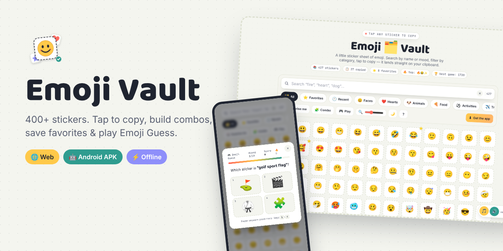

</div>

---

## ✨ Features

| | Feature | What it does |
|---|---|---|
| 📋 | **Tap to copy** | Every sticker lands straight on your clipboard — with a little emoji burst 💥 |
| 🔍 | **Smart search** | Search by name, mood or category (`fire`, `happy dog`) — or paste an emoji to find it |
| ⭐ | **Favorites** | Right-click or long-press any sticker → ☆ Favorite. Your own tab, saved on your device |
| 🕘 | **Recent** | Everything you copied, newest first |
| 🧩 | **Combo builder** | Tap several stickers to build a string like 🔥😂💯 and copy it all at once |
| ✋🏽 | **Skin tones** | 100+ hand & people emoji with all five skin-tone options |
| 🔎 | **Details sheet** | Big preview, keyword tags, Unicode code (`U+1F602`), HTML entity, related emoji, share |
| 🎲 | **Surprise me** | Spotlights and copies a random sticker |
| 🎮 | **Emoji Guess** | 10 timed rounds — faster answers + streaks = more points. Beat your 🏆 best score |
| 🌙 | **Dark mode** | Follows your system, or toggle it yourself |
| 🔍 | **Sticker size** | Zoom slider from tiny to huge |
| ⌨️ | **Keyboard friendly** | `/` search · arrows to move · `Enter` copy · `C` combo · `R` random · `G` game · `F` favorite · `D` dark |
| 🎵 | **Synth music + sfx** | Ambient generative music and click pops, all made with the Web Audio API — no audio files |
| 🔗 | **Deep links** | `?q=heart` opens straight to a search |

## 📸 Screenshots

<table>
<tr>
<td>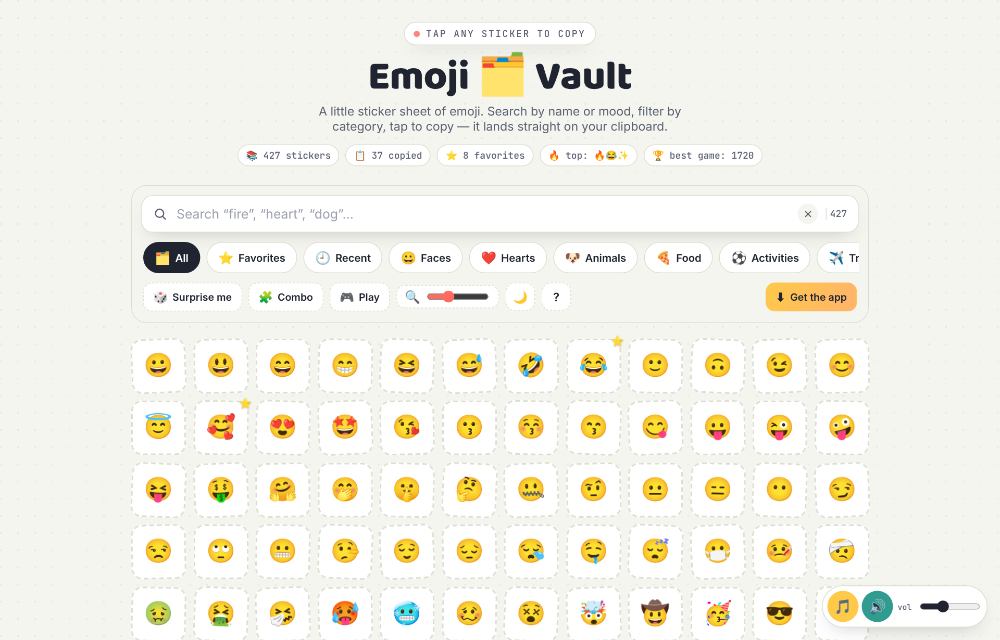<p align="center">🗂️ <b>The sticker sheet</b></p></td>
<td>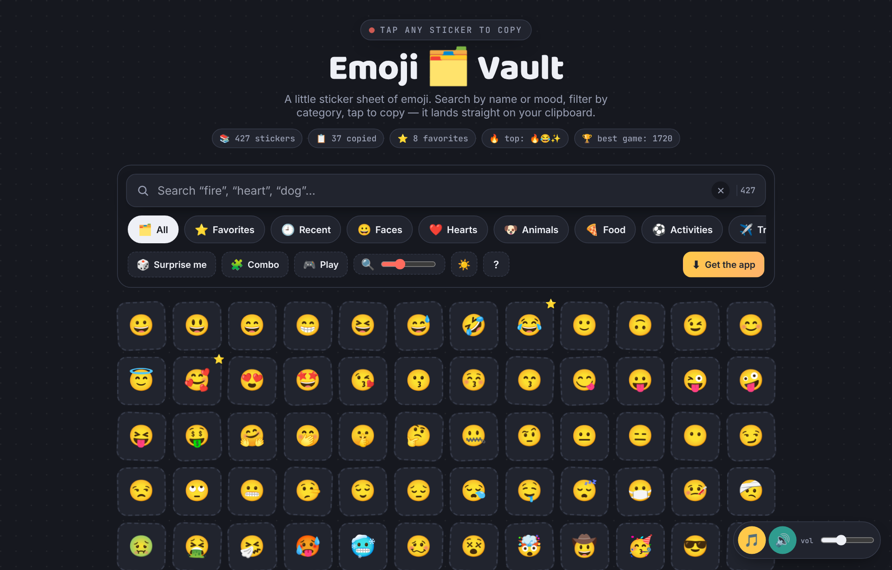<p align="center">🌙 <b>Dark mode</b></p></td>
</tr>
<tr>
<td>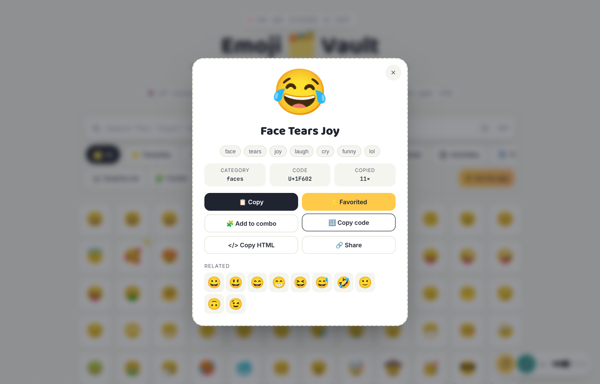<p align="center">🔎 <b>Details</b> — codes, tags, related</p></td>
<td>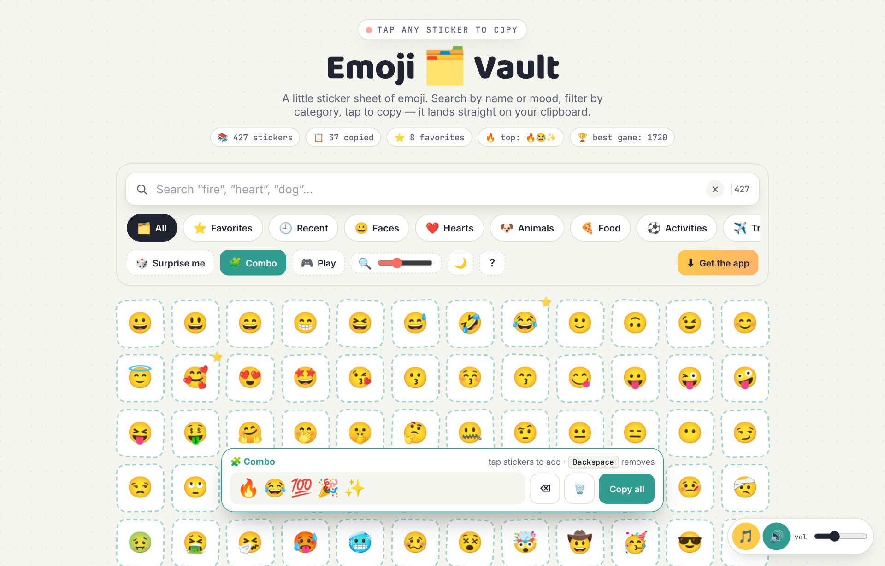<p align="center">🧩 <b>Combo builder</b></p></td>
</tr>
<tr>
<td>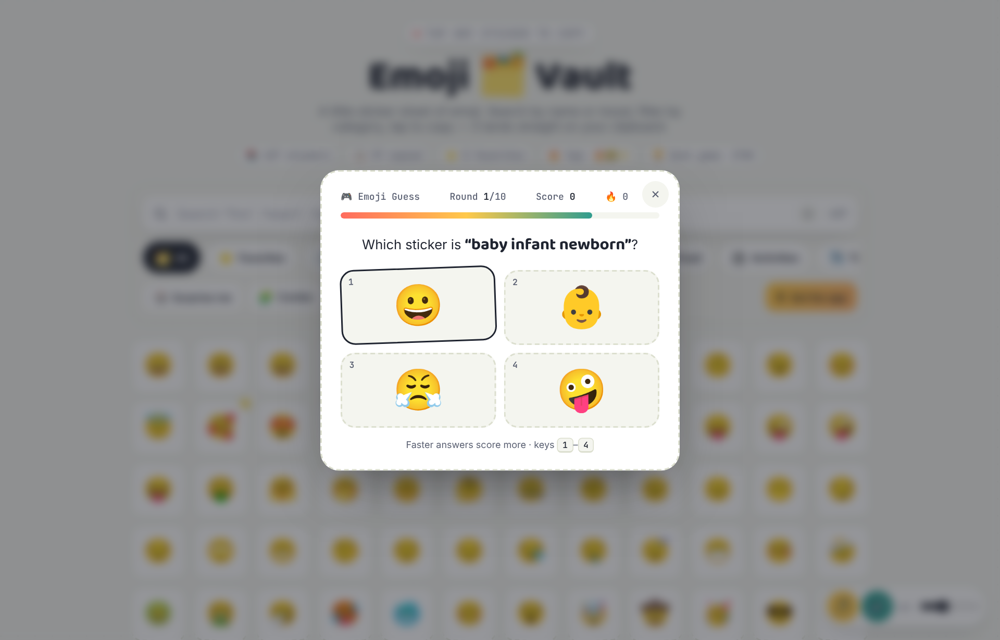<p align="center">🎮 <b>Emoji Guess</b> mini-game</p></td>
<td>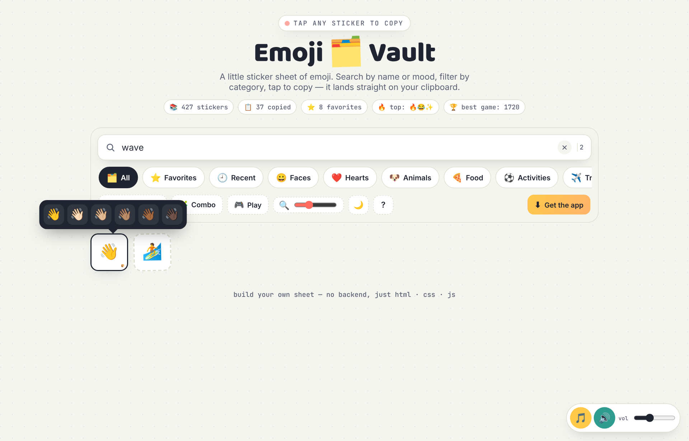<p align="center">✋🏽 <b>Skin-tone picker</b></p></td>
</tr>
</table>

<p align="center">
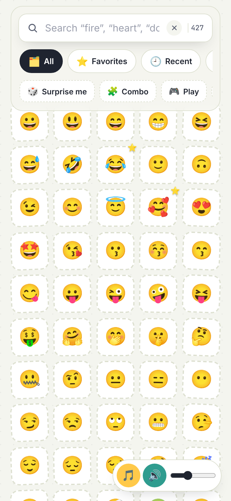
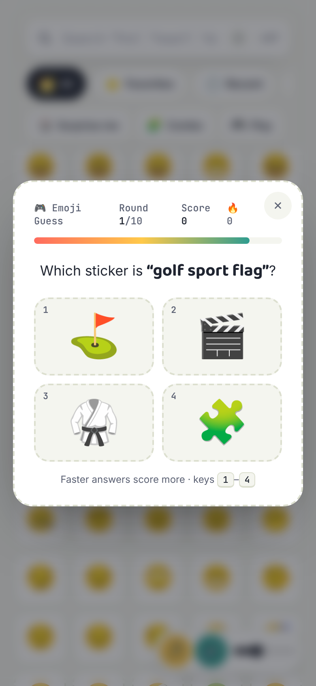
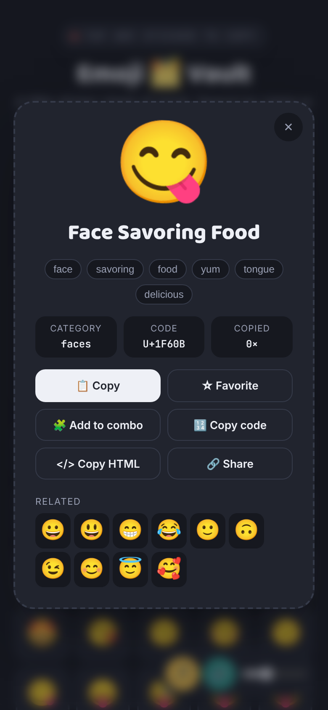
<br><em>📱 Made for phones — long-press for details, swipe the category chips</em>
</p>

## 📥 Get Emoji Vault

| Platform | How |
|---|---|
| 🌐 **Web** | Open **[jaineil32624.github.io/Emoji-Vault](https://jaineil32624.github.io/Emoji-Vault/)** — nothing to install |
| 🤖 **Android** | Download **[EmojiVault.apk](https://github.com/jaineil32624/Emoji-Vault/releases/latest/download/EmojiVault.apk)** → open it → allow *Install unknown apps* if asked |
| 💻 **Windows / Mac / Chromebook** | Open the website in Chrome or Edge → **⬇ Get the app** → **Install** |
| 🍎 **iPhone / iPad** | Open the website in Safari → **Share** → **Add to Home Screen** |
| 📦 **Offline zip** | Grab **EmojiVault-web.zip** from [Releases](https://github.com/jaineil32624/Emoji-Vault/releases/latest), unzip, open `index.html` |

> 💡 Works **100% offline** once installed. No account, no ads, no tracking — favorites and scores stay on your device.

<p align="center">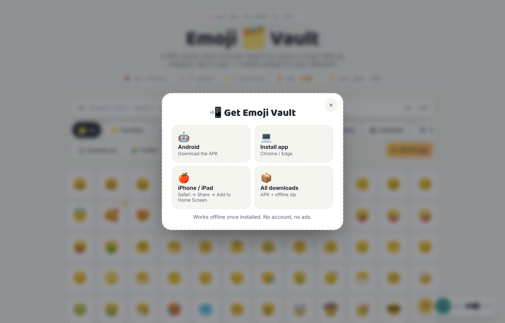</p>

## 🛠️ Run it locally

```bash
git clone https://github.com/jaineil32624/Emoji-Vault.git
cd Emoji-Vault
python3 -m http.server 8000      # then open http://localhost:8000
```

It's a single `index.html` — no build step, no dependencies.

## 🗂️ Project structure

```
Emoji-Vault/
├── index.html              🧱 the whole app: data, styles, logic, synth audio
├── sw.js                   📴 offline service worker
├── manifest.webmanifest    📲 installable-app manifest
├── icons/                  🖼️ app icons (SVG + PNG + maskable)
├── vendor/                 🔤 fonts bundled for offline use
├── docs/screenshots/       📸 images for this README
├── VERSION                 🏷️ bump to publish a new release
└── .github/workflows/
    ├── release.yml         🤖 builds the Android APK + publishes a Release
    └── vendor.yml          ⬇️ refreshes the offline fonts
```

## 🚀 Releasing a new version

Bump the number in `VERSION` and push — GitHub Actions builds the APK and publishes the release automatically:

```bash
echo "1.1.0" > VERSION
git commit -am "Release 1.1.0" && git push
```

## ➕ Adding emoji

Add a row to the `DATA` array in `index.html`: `["🦄","unicorn magic horse fantasy","animals"]` — emoji, search keywords, category. Skin-tone support is detected automatically.

---

<div align="center">

Made with 💛, ☕ and way too many 😂 by **[Jaineil Rana](https://github.com/jaineil32624)**

⭐ *If Emoji Vault saved you a scroll, give it a star!* ⭐

</div>
